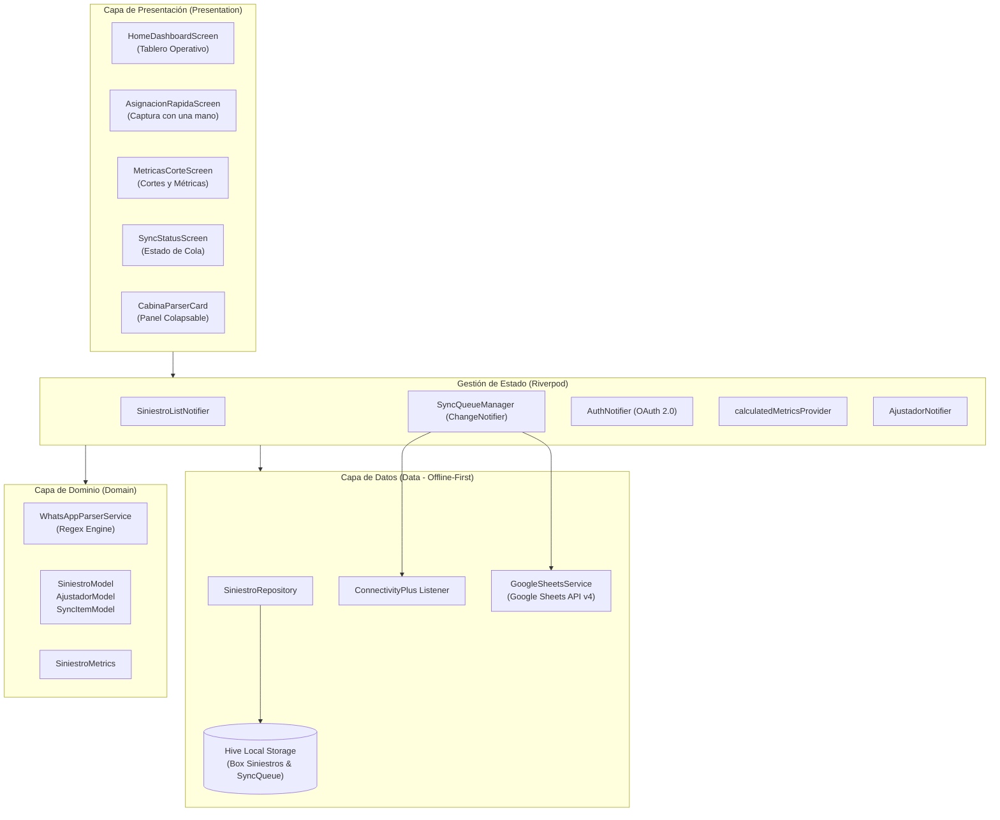

# Asignación AACH 🚗📋

> **Sistema Móvil Offline-First para el Registro, Asignación Rápida y Control Operativo de Siniestros Viales en México**  
> *Construido con Flutter, Clean Architecture, Riverpod, Hive y Google Workspace Sheets API v4.*

[](https://flutter.dev)
[](https://dart.dev)
[](#arquitectura-de-software)
[](#estrategia-offline-first)
[](#integración-serverless-con-google-sheets)
[](LICENSE)

---

## 📌 1. Problema Operativo Resuelto

En la industria de ajuste y atención de siniestros vehiculares en México, la coordinación operativa entre cabinas de aseguradoras (Quálitas, GNP, Inbursa, AXA, HDI, Chubb, Mapfre, etc.) y los ajustadores en campo presenta retos críticos:

1. **Zonas sin Cobertura Celular:** Los siniestros viales suelen suscitarse en carreteras, pasos a desnivel, túneles o perímetros con nula señal móvil, donde una aplicación móvil convencional basada en API REST falla o pierde datos.
2. **Saturación y Retraso en Captura:** Los reportes de cabina son enviados por WhatsApp con formatos heterogéneos y desestructurados. Transcribirlos manualmente bajo la presión del tráfico genera errores humanos y retrasa el arribo del ajustador.
3. **Costo de Servidores Innecesario:** Pequeños y medianos despachos de ajustadores no requieren pagar infraestructura en AWS/GCP (bases de datos relacionales, contenedores, balanceadores). Requieren una solución **serverless de costo cero** que se sincronice directamente con su herramienta diaria de control: **Google Sheets**.

**Asignación AACH** resuelve esta problemática de raíz mediante una arquitectura **Offline-First**, un **Parser de WhatsApp con expresiones regulares tolerantes**, apertura directa de WhatsApp con fichas operativas preformateadas y un motor de cola de sincronización con Google Sheets API v4.

---

## 🏗️ 2. Arquitectura de Software

La aplicación está diseñada bajo los principios de **Clean Architecture** y organización modular **Feature-First**, garantizando independencia entre la lógica de negocio, los servicios de infraestructura y la interfaz de usuario:



---

## 🚀 3. Requerimientos y Módulos Implementados

### 1. Parser Inteligente de WhatsApp (`WhatsAppParserService`)
- Panel colapsable táctil **"Pegar mensaje de Cabina"** en la pantalla de asignación.
- Motor de expresiones regulares (Regex) multiformato tolerante a negritas, saltos de línea y emojis de WhatsApp.
- Extrae de manera instantánea:
  - **Folio / Número de Siniestro** (ej. `0424123456`, `INB-99887766`, `GNP2024-554433`).
  - **Aseguradora** normalizada contra el catálogo (Quálitas, GNP, Inbursa, AXA, HDI, Chubb, Mapfre, Banorte, etc.).
  - **Asegurado y Teléfono** de contacto limpio (10 dígitos).
  - **Vehículo:** Marca, submarca, modelo, color y placas.
  - **Ubicación y Enlace de Google Maps** (`maps.app.goo.gl`, `goo.gl/maps` o coordenadas lat/lng).
- Botón **"Autocompletar Formulario"** que traslada los datos al formulario con un solo toque.

### 2. Formulario de Asignación Rápida (UX con una sola mano)
- Diseñado para su uso en campo o al volante en situaciones de urgencia:
  - Selectores horizontales con `ChoiceChips` de aseguradoras y tipos de siniestro (*Choque, Robo, Cristal, Asistencia Vial, Daños a Terceros*).
  - Selector de ajustador asignado con catálogo precargado (*Axel, Alejandro, Ian, Luis*).
  - Botón de pegado directo desde el portapapeles para el folio.
  - Geolocalización satelital actual con un toque (`geolocator`).
  - **Acción Principal ("Guardar y Enviar por WhatsApp"):** Persiste el siniestro en Hive, encola la sincronización a Sheets y abre la app de WhatsApp nativa con la ficha operativa formateada enviada directamente al número del ajustador asignado.

### 3. Tablero Operativo y Control de Estatus
- Pestañas de filtrado ágil:
  - 🟡 **Asignado**
  - 🔵 **En Atención / Arribo**
  - 🟢 **Concluido** (con selector modal de tipo de cierre: *Con Convenio, Sin Convenio, Volante de Admisión, Deducible Cobrado, Solo Asistencia, Rechazado en Cabina, Pase Médico*).
  - 🔴 **Cancelado / Falso**
- **Indicador Dinámico de Tiempo Transcurrido:** Cuenta minutos y horas desde la asignación (`Hace 12 min`, `Hace 1h 25m`) con alertas visuales de color cuando se excede el SLA operativo (> 45 min en asignado).
- Acciones rápidas de un toque: llamada telefónica directa (`tel:`), apertura en Google Maps y reenvío de ficha por WhatsApp.

### 4. Sincronización Serverless con Google Sheets (`GoogleSheetsSyncService`)
- Autenticación OAuth 2.0 mediante Google Sign-In.
- **Auto-inicialización de Pestañas:** Si la hoja vinculada está vacía, la app crea y estructura automáticamente las pestañas con encabezados y formatos congelados:
  - `SINIESTROS` (21 columnas con ID, Folio, Aseguradora, Ajustador, Estatus, Ubicación, Tiempos, etc.)
  - `AJUSTADORES` (Catálogo maestro de ajustadores y teléfonos)
  - `CATALOGO_ASEGURADORAS` (Aseguradoras, prefijos y teléfonos de emergencia)
- **Cola Offline (`SyncQueueManager`):** Monitorea cambios de conectividad con `connectivity_plus`. Al detectar red, procesa la cola de transacciones pendientes en segundo plano sin bloquear la UI.
- **Indicador Visual en AppBar:** Muestra en tiempo real si el sistema está al día (🟢), tiene registros offline en cola (🟠) o está subiendo datos (🔵).

### 5. Corte Operativo, Métricas y Exportación
- Filtros por período (*Hoy, Semana Actual, Quincena, Mes, Histórico*), Aseguradora y Ajustador.
- Tarjetas KPI: Total de siniestros, efectividad de conclusión, tiempos promedio de arribo y atención.
- Gráfica porcentual de desglose de tipos de cierre.
- **Exportación Dual:**
  1. Generación de archivo **CSV / Excel** y compartición inmediata por correo o drive (`share_plus`).
  2. Generación de **Corte Formateado para WhatsApp**, listo para enviarse al grupo de coordinación general.

---

## 🛠️ 4. Stack Tecnológico

| Componente | Tecnología | Versión | Justificación |
|---|---|---|---|
| **Framework** | Flutter | 3.50.0 | Rendimiento nativo Android de 60/120 FPS y diseño Material 3 adaptativo. |
| **Lenguaje** | Dart (Sound Null-Safety) | 3.14.0 | Tipado estricto, robustez y compilación AOT. |
| **Gestión de Estado** | Riverpod | ^2.6.1 | Estado reactivo, inmutable y desacoplado, ideal para testabilidad. |
| **Persistencia Local** | Hive & Hive Flutter | ^2.2.3 | Base de datos NoSQL ultrarrápida, ligera, sin dependencias nativas complejas. |
| **Backend Serverless** | Google Sheets API v4 | ^13.2.0 | Cero costo mensual de servidor; integración directa con hojas de cálculo. |
| **Autenticación** | Google Sign-In | ^6.3.0 | OAuth 2.0 nativo en Android con permisos acotados (`spreadsheets`). |
| **GPS y Hardware** | Geolocator | ^12.0.0 | Adquisición precisa de coordenadas de campo para arribo y rutas. |
| **Lanzador de Enlaces** | URL Launcher | ^6.3.3 | Invocación de esquemas nativos `whatsapp://`, `tel:` y `https://`. |
| **Exportación** | CSV & Share Plus | ^6.0.0 / ^10.1.4 | Generación y compartición de hojas de cálculo operativas. |

---

## 📁 5. Estructura del Proyecto

```text
lib/
├── main.dart                                # Punto de entrada, inicio de Hive y ProviderScope
├── core/
│   ├── constants/
│   │   ├── app_constants.dart               # Catálogos de aseguradoras, eventos y cajas Hive
│   │   └── sheets_config.dart               # Definición de pestañas y columnas de Google Sheets
│   ├── services/
│   │   ├── export_service.dart              # Generador de CSV y cortes formateados para WhatsApp
│   │   ├── location_service.dart            # Geolocalización GPS y generación de enlaces de Maps
│   │   └── whatsapp_service.dart            # Armado de fichas operativas y launcher de WhatsApp
│   ├── theme/
│   │   ├── app_colors.dart                  # Paleta M3, colores de estatus e identidad de aseguradoras
│   │   └── app_theme.dart                   # Temas Claro y Oscuro adaptativos
│   └── utils/
│       ├── date_formatter.dart              # Formateo de fechas y cálculo de tiempo transcurrido
│       └── string_extensions.dart           # Normalización de teléfonos mexicanos (+521)
├── domain/
│   ├── models/
│   │   ├── ajustador_model.dart             # Entidad Ajustador (Axel, Alejandro, Ian, Luis)
│   │   ├── aseguradora_model.dart           # Entidad Aseguradora
│   │   ├── siniestro_metrics.dart           # Entidad para métricas y cortes
│   │   ├── siniestro_model.dart             # Entidad Maestra de Siniestro (21 atributos)
│   │   └── sync_item_model.dart             # Elemento transaccional de cola offline
│   └── services/
│       └── whatsapp_parser_service.dart     # Motor Regex de extracción inteligente de cabinas
├── data/
│   ├── datasources/
│   │   ├── google_sheets_service.dart       # Cliente Google Sheets API v4 autenticado
│   │   └── local_storage_service.dart       # Persistencia local Hive
│   ├── repositories/
│   │   └── siniestro_repository.dart        # Implementación Offline-First con encolamiento
│   └── sync/
│       └── sync_queue_manager.dart          # Administrador de cola de sincronización en red
└── presentation/
    ├── providers/                           # Notifiers de Riverpod (Auth, Siniestros, Sync, etc.)
    ├── screens/
    │   ├── ajustes_screen.dart              # Configuración de Google OAuth y Catálogo
    │   ├── asignacion_rapida_screen.dart    # Formulario táctil rápido con Parser
    │   ├── detalle_siniestro_screen.dart    # Vista completa, cambio de estado y acciones
    │   ├── home_dashboard_screen.dart       # Tablero Operativo y NavigationBar
    │   ├── metricas_corte_screen.dart       # Métricas KPI y exportación CSV/WhatsApp
    │   └── sync_status_screen.dart          # Monitor de cola y forzado de sincronización
    └── widgets/
        ├── cabina_parser_card.dart          # Card colapsable de análisis de WhatsApp
        ├── metric_summary_card.dart         # KPI visual
        ├── quick_filter_bar.dart            # Buscador y chips de estatus
        ├── siniestro_card.dart              # Tarjeta operativa con alertas de tiempo
        └── sync_indicator_badge.dart        # Badge de estado en AppBar
```

---

## ⚙️ 6. Configuración de Google Cloud y OAuth 2.0

Para vincular la aplicación con su hoja de cálculo maestra de Google Sheets, consulte la guía detallada:

👉 **[Guía Paso a Paso de Google Cloud Console](docs/SETUP_GOOGLE_CLOUD.md)**

### Pasos Resumidos:
1. Crear proyecto en Google Cloud y habilitar la **Google Sheets API**.
2. Configurar la pantalla de consentimiento OAuth (permisos `spreadsheets`).
3. Registrar la credencial OAuth de tipo Android con el paquete `com.aach.asignacion_siniestros` y la huella digital `SHA-1` de firma.
4. Crear una hoja en Google Sheets, copiar el `Spreadsheet ID` e ingresarlo en la pantalla de **Ajustes** de la app.

---

## 📱 7. Compilación y Despliegue Android (APK)

### 7.1 Requisitos Previos
- Flutter SDK 3.24+ o superior.
- Java Development Kit (JDK 17).
- Android SDK (API Level 34).

### 7.2 Comandos de Compilación
```bash
# 1. Obtener paquetes y dependencias
flutter pub get

# 2. Ejecutar análisis estático (0 errores garantizados)
flutter analyze

# 3. Ejecutar suite de pruebas unitarias
flutter test

# 4. Compilar APK de lanzamiento optimizado
flutter build apk --release
```

El archivo generado se encontrará en:
`build/app/outputs/flutter-apk/app-release.apk`

---

## 🔒 8. Seguridad y Control de Versiones

El repositorio incluye directivas estrictas en `.gitignore` para proteger secretos comerciales y credenciales:
- Llaves privadas de firma (`*.jks`, `*.keystore`, `key.properties`).
- Metadatos de Firebase / Google Cloud (`google-services.json`).
- Variables de entorno (`.env`). Se provee [.env.example](.env.example) como plantilla de configuración segura.

---

## 👨‍💻 Autor y Créditos

Desarrollado con estándares de ingeniería de software para el despacho **AACH Ajustadores Asociados**.  
Repositorio Oficial: [https://github.com/luisgudinhoc-bit/Asignacion_AACH.git](https://github.com/luisgudinhoc-bit/Asignacion_AACH.git)
